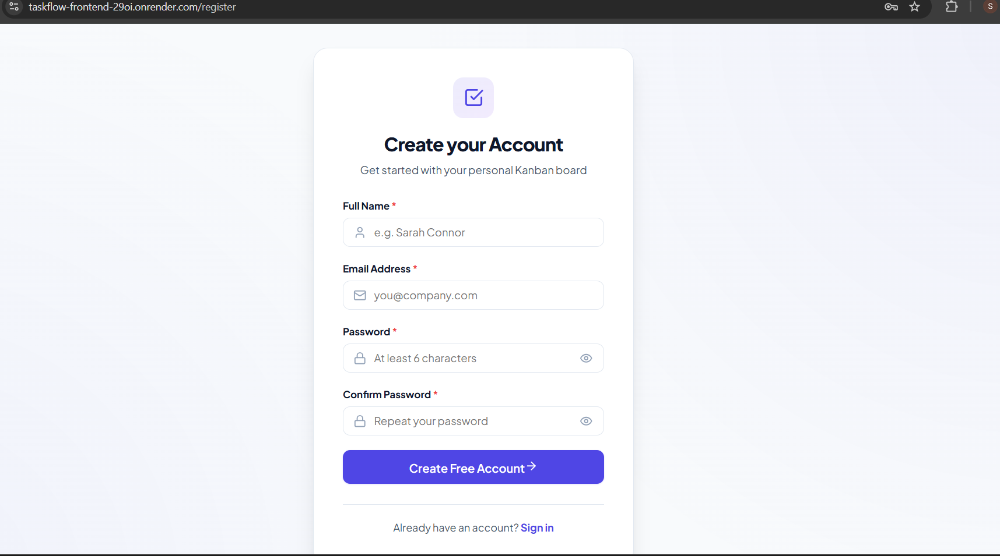
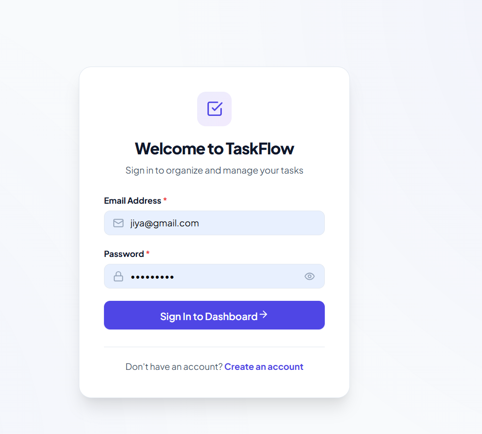
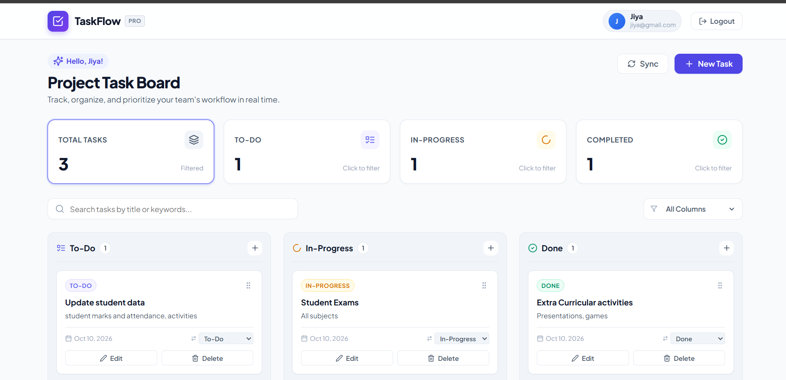
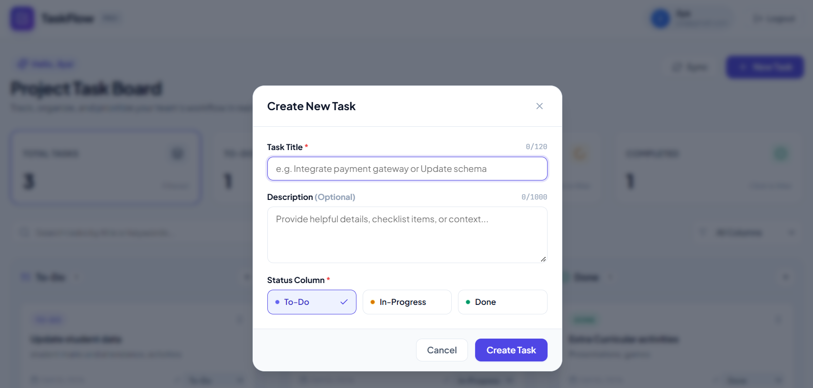

# TaskFlow — Mini Kanban-Style Task Management System

[](https://react.dev/)
[](LICENSE)
[](https://render.com/)

> A full-stack Mini Kanban Task Management Web Application built for the **Aarvion Services India Pvt. Ltd. Full Stack Developer Assessment**.

TaskFlow enables users to register, securely log in, and manage their productivity workflows across three distinct Kanban columns (**To-Do**, **In-Progress**, and **Done**) with summary metrics, drag-and-drop support, and user-specific task management.

---

## 🌐 Live Demo

- **Frontend Application:** [TaskFlow](https://taskflow-frontend-29oi.onrender.com)
- **Backend Health Check:** [TaskFlow API](https://taskflow-backend-ddlu.onrender.com/api/health)
- **Source Code:** [GitHub Repository](https://github.com/Saniyabagsar/TaskFlow)

## 🖼️ Application Screenshots

### Registration Page



### Login Page



### Kanban Dashboard



### Task Management



## 🌟 Key Features

### 🔐 Authentication & Security

- **JWT-Based Authentication**: Uses JSON Web Tokens for user authentication.
- **Password Security**: Uses `bcryptjs` for password hashing.
- **Protected Routes**: Restricts access to protected pages and API endpoints.
- **User-Specific Tasks**: Users can manage their own tasks.
- **Security Middleware**: Uses security-related middleware and request validation in the backend.

### 📋 Kanban Dashboard & Task Management

- **3 Distinct Kanban Columns**: Dedicated visual styling and badges for **To-Do** (Indigo), **In-Progress** (Amber), and **Done** (Emerald).
- **Interactive Drag-and-Drop**: Built using `@dnd-kit/core` to move tasks between Kanban columns.
- **Full CRUD Operations**:
  - Create tasks with a title, description, and initial column status.
  - Edit task titles, descriptions, and statuses inline or via a modal.
  - Delete tasks with confirmation dialogs.
  - Quick status dropdown / shift controls as an alternative to drag-and-drop.
- **Summary Metrics**: Dashboard cards displaying total task counts and column breakdowns.
- **Live Search & Filter**: Search across titles and descriptions and filter tasks by column status.
- **Toast Feedback**: User feedback for actions using `react-hot-toast`.
- **Responsive SaaS UI**: Layout designed for mobile, tablet, and desktop screens.

---

## 🛠️ Technology Stack

| Layer | Technology | Purpose |
|---|---|---|
| **Frontend** | React 18 (Vite) | Single Page Application (SPA) user interface |
| **Routing** | React Router v6 | Client-side routing and protected route wrappers |
| **State Management** | React Context API | Authentication and user session state |
| **HTTP Client** | Axios | API communication |
| **Drag and Drop** | @dnd-kit/core | Drag-and-drop Kanban column transitions |
| **Icons & UI** | Lucide React | Icons and interface elements |
| **Notifications** | react-hot-toast | Toast notifications |
| **Backend** | Node.js & Express.js | REST API server |
| **Database** | MongoDB Atlas & Mongoose | NoSQL database and data modeling |
| **Validation** | express-validator | Request validation |
| **Security** | bcryptjs, jsonwebtoken, helmet, cors | Authentication and security-related middleware |
| **Testing** | Jest, Supertest, mongodb-memory-server | Testing tools |
| **Hosting** | Render & MongoDB Atlas | Application hosting and cloud database |

---

## 📁 Repository & Monorepo Structure

```text
TaskFlow/
├── client/                     # Frontend React (Vite) Application
│   ├── public/                 # Static assets & _redirects for SPA routing
│   │   ├── _redirects          # Netlify / Render static rewrites
│   │   └── favicon.svg         # TaskFlow brand icon
│   ├── src/
│   │   ├── api/                # Centralized Axios client & API services
│   │   │   ├── axios.js        # Axios instance with interceptors
│   │   │   ├── authApi.js      # Auth API endpoints
│   │   │   └── taskApi.js      # Task CRUD API endpoints
│   │   ├── components/         # Reusable UI components
│   │   │   ├── ConfirmDialog.jsx
│   │   │   ├── EmptyState.jsx
│   │   │   ├── KanbanColumn.jsx
│   │   │   ├── LoadingSpinner.jsx
│   │   │   ├── MetricCards.jsx
│   │   │   ├── Navbar.jsx
│   │   │   ├── ProtectedRoute.jsx
│   │   │   ├── TaskCard.jsx
│   │   │   └── TaskModal.jsx
│   │   ├── context/            # Global React Context
│   │   │   └── AuthContext.jsx # Authentication state & token management
│   │   ├── pages/              # Application views
│   │   │   ├── Dashboard.jsx   # Main Kanban board & metric dashboard
│   │   │   ├── Login.jsx       # User login page
│   │   │   ├── Register.jsx    # User registration page
│   │   │   └── NotFound.jsx    # 404 Error page
│   │   ├── styles/
│   │   │   └── index.css       # SaaS design system & responsive styling
│   │   ├── App.jsx             # Route definitions & toast provider
│   │   └── main.jsx            # React root mounting
│   ├── .env.example            # Frontend environment variable templates
│   ├── index.html              # HTML shell
│   ├── package.json            # Frontend dependencies
│   └── vite.config.js          # Vite configuration
│
├── server/                     # Backend Node.js / Express API
│   ├── src/
│   │   ├── config/
│   │   │   └── db.js           # Mongoose MongoDB connection handler
│   │   ├── controllers/        # Business logic handlers
│   │   │   ├── authController.js
│   │   │   └── taskController.js
│   │   ├── middleware/         # Custom Express middlewares
│   │   │   ├── authMiddleware.js
│   │   │   ├── errorMiddleware.js
│   │   │   └── notFoundMiddleware.js
│   │   ├── models/             # Mongoose schemas
│   │   │   ├── User.js
│   │   │   └── Task.js         # Task model
│   │   ├── routes/             # RESTful API route definitions
│   │   │   ├── authRoutes.js
│   │   │   ├── taskRoutes.js
│   │   │   └── healthRoutes.js
│   │   ├── validators/         # Request validation rules
│   │   │   ├── authValidators.js
│   │   │   └── taskValidators.js
│   │   ├── app.js              # Express app setup, CORS, and middleware
│   │   └── server.js           # Server entry point
│   ├── tests/                  # Automated tests
│   │   └── api.test.js         # Jest/Supertest test suite
│   ├── .env.example            # Backend environment variable templates
│   └── package.json            # Backend dependencies & test scripts
│
├── .gitignore                  # Monorepo root gitignore
├── package.json                # Root orchestration package scripts
└── README.md                   # Project documentation
```

---

## 🚀 Getting Started Locally

### Prerequisites

- **Node.js**: v18.0.0 or higher (v20+ recommended)
- **npm**: v9.0.0 or higher
- **MongoDB**: A free MongoDB Atlas cluster or a local MongoDB instance (`mongodb://localhost:27017/taskflow`)

---

### Step 1: Clone the Repository

```bash
git clone https://github.com/Saniyabagsar/TaskFlow.git
cd TaskFlow
```

---

### Step 2: Configure Environment Variables

#### 1. Backend Environment Setup (`server/.env`)

Create a `.env` file in the `server` directory:

```bash
cp server/.env.example server/.env
```

Fill in the required configuration:

```env
PORT=5000
NODE_ENV=development
MONGODB_URI=mongodb+srv://<username>:<password>@cluster0.example.mongodb.net/taskflow?retryWrites=true&w=majority
JWT_SECRET=replace_with_a_secure_secret_of_at_least_32_characters
JWT_EXPIRES_IN=7d
CLIENT_URL=http://localhost:5173
```

Replace the MongoDB URI and JWT secret with your own configuration values.

#### 2. Frontend Environment Setup (`client/.env`)

Create a `.env` file in the `client` directory:

```bash
cp client/.env.example client/.env
```

Add the backend API base URL:

```env
VITE_API_URL=http://localhost:5000/api
```

---

### Step 3: Install Dependencies

You can install all dependencies from the root directory:

```bash
npm run install:all
```

Or install them individually:

```bash
npm --prefix server install
npm --prefix client install
```

---

### Step 4: Run the Application

#### Option A: Start both services separately

Run the server in terminal 1:

```bash
npm run dev:server
```

Run the client in terminal 2:

```bash
npm run dev:client
```

#### Local Access URLs

- **Frontend App**: [http://localhost:5173](http://localhost:5173)
- **Backend API**: [http://localhost:5000](http://localhost:5000)
- **Health Check Endpoint**: [http://localhost:5000/api/health](http://localhost:5000/api/health)

---

## 🧪 Automated Testing

The project includes a test suite for checking application functionality.

To run the tests:

```bash
npm run test:server
```

Or from inside the `server/` directory:

```bash
cd server
npm test
```

---

## 📡 REST API Documentation

### Base URL: `/api`

### 1. Health Check

| Method | Endpoint | Access | Description |
|---|---|---|---|
| `GET` | `/api/health` | Public | Returns server status, uptime, and database connection state |

#### Example Response (`200 OK`)

```json
{
  "status": "healthy",
  "service": "TaskFlow Backend API",
  "environment": "development",
  "database": "connected",
  "uptime": "120s",
  "timestamp": "2026-10-10T10:00:00.000Z"
}
```

---

### 2. Authentication Endpoints

| Method | Endpoint | Access | Description |
|---|---|---|---|
| `POST` | `/api/auth/register` | Public | Register a new user and generate a JWT token |
| `POST` | `/api/auth/login` | Public | Authenticate user credentials and return a JWT token |
| `GET` | `/api/auth/me` | Protected | Fetch the current logged-in user profile |

#### `POST /api/auth/register`

**Request Body:**

```json
{
  "name": "Jane Doe",
  "email": "jane@example.com",
  "password": "password123"
}
```

**Example Response (`201 Created`):**

```json
{
  "success": true,
  "message": "Registration successful. Welcome to TaskFlow!",
  "data": {
    "user": {
      "id": "664f8a...",
      "name": "Jane Doe",
      "email": "jane@example.com",
      "createdAt": "2026-10-10T10:00:00.000Z"
    },
    "token": "eyJhbGciOiJIUzI1NiIsInR5cCI6IkpXVCJ9..."
  }
}
```

#### `POST /api/auth/login`

**Request Body:**

```json
{
  "email": "jane@example.com",
  "password": "password123"
}
```

**Example Response (`200 OK`):**

```json
{
  "success": true,
  "message": "Login successful.",
  "data": {
    "user": {
      "id": "664f8a...",
      "name": "Jane Doe",
      "email": "jane@example.com"
    },
    "token": "eyJhbGciOiJIUzI1NiIsInR5cCI6IkpXVCJ9..."
  }
}
```

---

### 3. Task Management Endpoints (Protected with `Bearer <token>`)

| Method | Endpoint | Description |
|---|---|---|
| `GET` | `/api/tasks` | Get tasks belonging to the authenticated user (supports `?status=` and `?search=`) |
| `GET` | `/api/tasks/:id` | Get a single task by ID |
| `POST` | `/api/tasks` | Create a new task |
| `PUT` | `/api/tasks/:id` | Update task title, description, and status |
| `PATCH` | `/api/tasks/:id/status` | Update task status only (`To-Do`, `In-Progress`, `Done`) |
| `DELETE` | `/api/tasks/:id` | Delete a task |

#### `POST /api/tasks`

**Headers:** `Authorization: Bearer <token>`

**Request Body:**

```json
{
  "title": "Design Database Schema",
  "description": "Create MongoDB Mongoose schemas for Users and Tasks",
  "status": "To-Do"
}
```

**Example Response (`201 Created`):**

```json
{
  "success": true,
  "message": "Task created successfully.",
  "data": {
    "_id": "664f8b...",
    "title": "Design Database Schema",
    "description": "Create MongoDB Mongoose schemas for Users and Tasks",
    "status": "To-Do",
    "userId": "664f8a...",
    "createdAt": "2026-10-10T10:05:00.000Z",
    "updatedAt": "2026-10-10T10:05:00.000Z"
  }
}
```

#### `PATCH /api/tasks/:id/status`

**Headers:** `Authorization: Bearer <token>`

**Request Body:**

```json
{
  "status": "In-Progress"
}
```

**Example Response (`200 OK`):**

```json
{
  "success": true,
  "message": "Task status updated to In-Progress.",
  "data": {
    "_id": "664f8b...",
    "title": "Design Database Schema",
    "status": "In-Progress",
    "updatedAt": "2026-10-10T10:10:00.000Z"
  }
}
```

---

## 🔒 Security & Architecture Decisions

- **Authentication**: User authentication is handled using JSON Web Tokens (JWT).
- **Password Security**: Passwords are hashed using `bcryptjs`.
- **Route Protection**: Authentication middleware is used for protected API routes.
- **Input Validation**: Request validation is handled using `express-validator` and Mongoose schema validation.
- **User-Specific Task Management**: The application is designed so users manage their own tasks.
- **Error Handling**: Backend middleware handles application errors.
- **Application Lifecycle**: The backend includes a server entry point for running the API.

---

## 👨‍💻 Submission Information

- **Candidate Name:** Saniya Bagsar
- **Company Assessment:** Aarvion Services India Pvt. Ltd.
- **Project:** TaskFlow — Mini Kanban-Style Task Management System
- **Repository:** [GitHub Repository](https://github.com/Saniyabagsar/TaskFlow)
- **Live Application:** [TaskFlow](https://taskflow-frontend-29oi.onrender.com)
- **Backend Health Check:** [TaskFlow API](https://taskflow-backend-ddlu.onrender.com/api/health)
- **Project Structure:** Single monorepo with `/client` and `/server`
